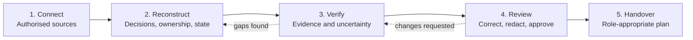
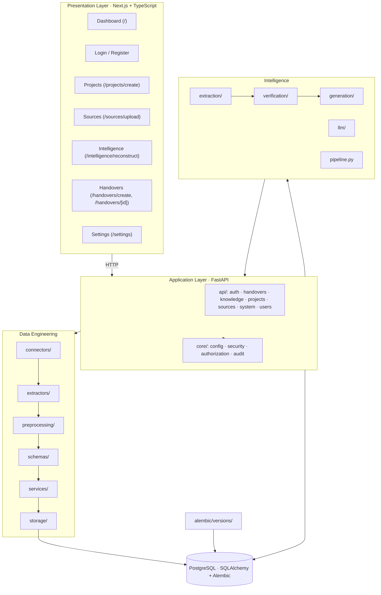

<div align="center">

# 🧭 HandoverOS

### Intelligent Knowledge Handover & Project Continuity Platform

**Preserve Knowledge. Maintain Continuity. Empower What Comes Next.**

[](https://www.python.org/)
[](https://fastapi.tiangolo.com/)
[](https://nextjs.org/)
[](https://www.typescriptlang.org/)
[](https://www.postgresql.org/)
[](https://www.docker.com/)
[](LICENSE)

[Overview](#-overview) · [Features](#-features) · [Workflow](#-workflow) · [Architecture](#-architecture) · [Tech Stack](#-tech-stack) · [Installation](#-installation) · [Running](#-running-the-application) · [Configuration](#-configuration) · [API](#-api-reference) · [Testing](#-testing) · [Security](#-security-and-privacy) · [Structure](#-project-structure) · [Roadmap](#-roadmap) · [Contributing](#-contributing) · [Team](#-team) · [License](#-license)

</div>

---

```text
Connect → Reconstruct → Verify → Review → Handover
```

> [!IMPORTANT]
> HandoverOS is a **decision-support tool**. Generated statements are proposals until an authorised reviewer approves them. AI output must never be treated as verified organisational truth, and information is never considered safe to share merely because it appears in a connected source.

## 🔎 Overview

HandoverOS converts scattered project activity into a structured, evidence-backed handover when a team member leaves, changes role or becomes unavailable. It reconstructs the current state of a project from **authorised sources**, identifies decisions, ownership, risks, blockers and next actions, links every important claim to its supporting source, and marks uncertainty rather than inventing answers.

| Principle | Meaning |
|---|---|
| 🔗 **Traceable** | Important statements link back to reliable supporting sources. |
| ✅ **Actionable** | The incoming person understands ownership, risks and next steps. |
| 🔐 **Permission-aware** | People see only the information they are authorised to access. |
| 🤝 **Human-controlled** | AI proposes; an authorised reviewer approves before distribution. |

### The problem

When people leave a project, documents may remain, but the reasoning behind decisions, unfinished work, dependencies, recurring problems and key contacts is scattered across repositories, messages, meeting notes and task boards. The result is:

- Delayed onboarding and project transitions
- Repeated investigations and duplicated work
- Lost decision context and unclear ownership of unfinished tasks
- Blockers and dependencies discovered too late
- Difficulty telling which information is current and reliable
- Risk of exposing confidential information through unrestricted sharing

The problem is not simply missing documentation. It is the difficulty of reconstructing **reliable, contextual and actionable** knowledge from fragmented records.

### The solution

1. Ingest authorised project material.
2. Normalise and validate it, preserving source identifiers and timestamps.
3. Use LLM-based extraction to identify decisions, responsibilities, risks, blockers, dependencies and pending tasks.
4. Link each claim to evidence and flag missing evidence, contradictions and uncertainty.
5. Let an authorised reviewer edit, reject, redact and approve the handover.
6. Share the approved handover only with authorised recipients.

## ✨ Features

| Feature | Description |
|---|---|
| 🔌 **Source ingestion** | Upload PDF and DOCX documents; identifiers, timestamps and metadata are preserved end to end. |
| 🧹 **Normalisation and validation** | Raw content is converted into consistent, validated records. |
| 🧠 **Knowledge extraction** | An LLM extracts decisions, tasks, risks, blockers and dependencies as schema-validated output. |
| 🔗 **Evidence linking** | Every extracted item keeps a reference to the source that supports it. |
| ⚠️ **Verification** | Contradictions and unsupported claims are flagged for review. |
| 👀 **Review and approval** | Reviewers inspect, correct and approve before anything is shared. |
| 📤 **Handover generation** | Generates a handover report from approved, evidence-backed knowledge. |
| 🔒 **Access control** | Session-based authentication, project roles (viewer, editor, owner) and audit logging. |
| 🏠 **Local-first AI** | Runs against a locally hosted LLM through Ollama. |

## 🔄 Workflow



| Stage | What happens |
|---|---|
| **01 Connect** | A project member uploads authorised sources. The ingestion engine validates input and preserves source identifiers, timestamps and metadata. |
| **02 Reconstruct** | The intelligence layer extracts decisions, responsibilities, unresolved questions, risks, blockers, dependencies and pending actions into structured records. |
| **03 Verify** | Claims are checked against their sources; missing evidence, contradictions, unsupported claims and unclear ownership are flagged. |
| **04 Review** | A reviewer edits, corrects, rejects and resolves contradictions. A project owner approves. |
| **05 Handover** | The approved report is shared with authorised incoming members. |

A handover report contains: project overview, current status, important decisions, responsibilities, pending tasks, risks and blockers, dependencies, unresolved questions, recommended next actions and supporting source references. See [`docs/user_workflow.md`](docs/user_workflow.md).

## 🏗️ Architecture

HandoverOS is a modular, API-driven three-tier system: a Next.js presentation layer, a FastAPI backend that orchestrates the data-engineering and intelligence packages, and a PostgreSQL persistence layer managed with SQLAlchemy and Alembic.



See [`docs/architecture.md`](docs/architecture.md) and [`docs/data_flow.md`](docs/data_flow.md) for the detailed design.

### ⚡ Backend (`backend/app/`)

The entry point is `backend/app/main.py`.

| Module | Responsibility |
|---|---|
| `api/auth.py` | Registration, login and logout |
| `api/handovers.py` | Handover creation, review and retrieval |
| `api/knowledge.py` | Knowledge reconstruction and knowledge items |
| `api/projects.py` | Project management and membership |
| `api/sources.py` | Source upload and retrieval |
| `api/system.py` | System health and status |
| `api/users.py` | User profile and listing |
| `core/config.py` | Application configuration |
| `core/security.py` | Security utilities |
| `core/authorization.py` | Role-based permission checks |
| `core/audit.py` | Audit logging |

### 🧱 Data Engineering (`backend/data_engineering/`)

An independent Python package with its own configuration, README and tests. It preserves **source identifiers, timestamps and original references** end to end so evidence linking stays possible downstream. See [`docs/data_engineering.md`](docs/data_engineering.md).

| Component | Path | Responsibility |
|---|---|---|
| Configuration | `config.py` | Pipeline configuration |
| Ingestion pipeline | `ingestion_pipeline.py` | End-to-end ingestion orchestration |
| Connectors | `connectors/base_connector.py`, `document_connector.py`, `synthetic_repository_loader.py` | Source connectors |
| Extractors | `extractors/document_extractor.py` | Content extraction from documents |
| Generators | `generators/repository_generator.py` | Synthetic repository data for development and demos |
| Preprocessing | `preprocessing/normalizer.py`, `validator.py` | Normalisation and validation |
| Schemas | `schemas/knowledge_schema.py`, `source_schema.py` | Source and knowledge schemas |
| Services | `services/evidence_service.py`, `knowledge_storage_service.py`, `knowledge_validation_service.py`, `retrieval_service.py`, `storage_service.py` | Business logic |
| Storage | `storage/database.py`, `init_db.py`, `knowledge_repository.py`, `models.py`, `repository.py`, `source_files.py` | Persistence layer |
| Tests | `tests/` | 12 unit test modules |

### 🤖 AI/LLM Knowledge Intelligence (`backend/intelligence/`)

| Component | Path | Responsibility |
|---|---|---|
| Configuration | `config.py` | Intelligence configuration |
| Pipeline | `pipeline.py` | End-to-end intelligence pipeline |
| Schemas | `schemas.py` | Knowledge item schemas |
| Adapters | `adapters.py` | Adapters to data-engineering records |
| Extraction | `extraction/extractor.py`, `prompts.py` | Knowledge extraction from sources |
| Verification | `verification/contradictions.py`, `evidence.py` | Contradiction and evidence verification |
| Generation | `generation/handover.py` | Handover report generation |
| LLM | `llm/client.py`, `factory.py`, `ollama_client.py` | LLM client interface, factory and Ollama client |
| Fixtures | `fixtures/expected_output.json`, `sample_sources.json` | Test fixtures |
| Tests | `tests/test_pipeline.py` | Pipeline tests |

Design principles:

- The AI **proposes**; a human **verifies**.
- Structured model output is validated before it is stored.
- Verified information is kept separate from uncertain interpretation.
- No finding reaches a final handover without an evidence reference and a review decision.

### 🖥️ Frontend (`frontend/src/`)

Next.js with TypeScript and the App Router.

| Route | Page | Purpose |
|---|---|---|
| `/` | `page.tsx` | Dashboard and project overview |
| `/login` | `login/page.tsx` | Login |
| `/register` | `register/page.tsx` | Registration |
| `/settings` | `settings/page.tsx` | Application preferences |
| `/projects/create` | `projects/create/page.tsx` | Create a project |
| `/sources/upload` | `sources/upload/page.tsx` | Upload sources |
| `/intelligence/reconstruct` | `intelligence/reconstruct/page.tsx` | Run reconstruction, inspect findings and evidence |
| `/handovers/create` | `handovers/create/page.tsx` | Create a handover |
| `/handovers/[id]` | `handovers/[id]/page.tsx` | Review a handover |
| `/[section]` | `[section]/page.tsx` | Section catch-all |

- **Shell and layout:** `auth-shell.tsx`, `layout.tsx`, `globals.css`
- **Components:** `components/dashboard/` (EvidencePanel, IntelligenceSummary, PipelineCard, ReadinessCard, StatTiles), `components/layout/` (MobileNav, Sidebar, ThemeToggle, Topbar), `components/ui/` (StatusChip)
- **Lib modules:** `api.ts` (typed backend client), `auth.ts`, `labels.ts`, `types.ts`, `metrics.ts`, `mock-data.ts`, `nav.ts`, `project-selection.ts`, `require-auth.ts`, `stages.ts`

### 🗄️ Database

Schema design is documented in [`docs/database_design.md`](docs/database_design.md). SQLAlchemy models live in `backend/data_engineering/storage/models.py`, and migrations are in `backend/alembic/versions/`:

| Migration | Purpose |
|---|---|
| `a46e340cb50a_create_initial_database_schema` | Initial schema |
| `a716f8874ee1_add_project_member_role_constraint` | Project member role constraint |
| `b3c9f1a2d4e5_add_source_records_table` | Source records |
| `c1d2e3f4a5b6_add_source_id_to_handover_items` | Link handover items to sources |
| `e85619cdeaea_add_user_sessions_table` | User sessions |

Every knowledge item retains its source references and review status.

## 🛠️ Tech Stack

| Layer | Technology | Role |
|---|---|---|
| 🖥️ Frontend | Next.js (App Router), React, TypeScript | Web application |
| ⚡ Backend | Python, FastAPI | REST API and application logic |
| ✔️ Validation | Pydantic | Structured validation of requests, sources and knowledge |
| 🗄️ Database | PostgreSQL | Persistent storage |
| 🔗 ORM and migrations | SQLAlchemy, Alembic | Database access and schema management |
| 🔐 Auth | Session-based authentication, RBAC | Authentication and authorisation |
| 🧠 AI / LLM | Ollama (local LLM) | Knowledge extraction and handover generation |
| 📄 Documents | PDF and DOCX extraction | Source ingestion |
| ✅ Testing | pytest | Unit and integration tests |
| 📦 Containers | Docker, Docker Compose | Reproducible environments |

Exact versions are pinned in `backend/requirements.txt` and `frontend/package.json`.

## 🚀 Installation

### 📋 Prerequisites

| Requirement | Needed for |
|---|---|
| [Git](https://git-scm.com/) | Cloning the repository |
| Python compatible with `backend/requirements.txt` | Backend and data engineering |
| Node.js and npm compatible with `frontend/package.json` | Frontend |
| [PostgreSQL](https://www.postgresql.org/) or [Docker](https://www.docker.com/) | Database |
| [Ollama](https://ollama.com/) | Local LLM for knowledge extraction |

### 1. Clone the repository

```bash
git clone https://github.com/Terminella/HandoverOS.git
cd HandoverOS
```

### 2. Configure the environment

```powershell
Copy-Item .env.example .env
```

macOS / Linux:

```bash
cp .env.example .env
```

Review `.env.example` and set the variables described in [Configuration](#-configuration). Do not commit secrets or credentials.

### 3. Set up the backend

```powershell
py -m venv .venv
.\.venv\Scripts\Activate.ps1
python -m pip install --upgrade pip
pip install -r backend/requirements.txt
```

macOS / Linux:

```bash
python3 -m venv .venv
source .venv/bin/activate
pip install -r backend/requirements.txt
```

### 4. Apply database migrations

With PostgreSQL running and `DATABASE_URL` set in `.env`:

```bash
cd backend
alembic upgrade head
cd ..
```

### 5. Set up the frontend

```bash
cd frontend
npm install
cd ..
```

### 6. Prepare the local LLM

Install and start [Ollama](https://ollama.com/), then pull the model configured in `backend/intelligence/config.py`:

```bash
ollama pull <model-name>
```

## 🚦 Running the Application

### 🔌 Ports and URLs

| Service | Address |
|---|---|
| ⚡ Backend API | `http://127.0.0.1:8000` |
| 📖 Interactive API docs | `http://127.0.0.1:8000/docs` |
| 🖥️ Frontend | `http://localhost:3000` |
| 🗄️ Database | Configured through `DATABASE_URL` in `.env` |

### ⚡ Backend

```bash
cd backend
uvicorn app.main:app --reload --host 127.0.0.1 --port 8000
```

### 🖥️ Frontend

In a second terminal:

```bash
cd frontend
npm run dev
```

### 🐳 Docker

From the repository root:

```bash
docker compose up --build
```

To build the backend image on its own:

```bash
docker build -t handoveros-backend ./backend
```

### 🔗 API connection and CORS

The frontend must be able to reach the backend origin, and the backend must allow the frontend origin through CORS. If you change a port, update the backend start command, the frontend API base URL (`frontend/src/lib/api.ts`) and the CORS settings together.

## 🔧 Configuration

Copy `.env.example` to `.env` and review it alongside `backend/app/core/config.py`, `backend/data_engineering/config.py` and `backend/intelligence/config.py`. Do not commit `.env` or any credentials.

| Group | Purpose |
|---|---|
| Application | Environment, host and port, CORS origins |
| Database | PostgreSQL connection (`DATABASE_URL`, `POSTGRES_PASSWORD`) |
| Administrators | `ADMIN_EMAILS` and `ADMIN_USER_IDS` |
| LLM | Ollama connection and model selection |

**Database.** Docker Compose requires a long, URL-safe `POSTGRES_PASSWORD`, because it is embedded in `DATABASE_URL`. PostgreSQL is bound to loopback rather than published on all host interfaces.

**Administrators.** Global user-list access requires both `ADMIN_EMAILS` (comma-separated, normalised email addresses) and `ADMIN_USER_IDS` (comma-separated user IDs) to match. Neither setting grants privileges by email alone, and public registration rejects `ADMIN_EMAILS` addresses. Because the application has no email-verification or admin-provisioning flow, create administrator accounts only through a trusted, operator-controlled provisioning process: verify the account identity out of band, then configure both its email and generated user ID. Do not assign an ID based only on a user-supplied email.

**Project roles.** Viewers have read-only access. Editors and owners may modify project sources, reconstruct knowledge and create handovers. Only owners may approve handovers.

## 📡 API Reference

| Area | Route module |
|---|---|
| 🔐 Authentication | [`backend/app/api/auth.py`](backend/app/api/auth.py) |
| 📁 Projects | [`backend/app/api/projects.py`](backend/app/api/projects.py) |
| 📄 Sources | [`backend/app/api/sources.py`](backend/app/api/sources.py) |
| 🧠 Knowledge | [`backend/app/api/knowledge.py`](backend/app/api/knowledge.py) |
| 📤 Handovers | [`backend/app/api/handovers.py`](backend/app/api/handovers.py) |
| 👤 Users | [`backend/app/api/users.py`](backend/app/api/users.py) |
| ❤️ System | [`backend/app/api/system.py`](backend/app/api/system.py) |

While the server is running, the interactive schema at `/docs` is the authoritative source for methods, request bodies, response models and paths. Full reference: [`docs/api_documentation.md`](docs/api_documentation.md).

## ✅ Testing

| Location | Scope |
|---|---|
| `backend/data_engineering/tests/` | Connectors, extraction, normalisation, validation, schemas, storage, retrieval, evidence and the ingestion pipeline (12 modules) |
| `backend/intelligence/tests/` | `test_pipeline.py`: intelligence pipeline |
| `backend/tests/` | `test_auth.py`, `test_rbac.py`, `test_project_members.py`, `test_security_config.py`, `test_knowledge_reconstruction.py`, `test_source_detail.py`, `test_migration_source_id.py`, `test_ollama_integration.py` |
| `tests/` | `test_workflow.py`: workflow-level test |

```bash
python -m pytest -v
```

Tests that depend on external services, such as the Ollama integration test, need that service running. See [`docs/testing_strategy.md`](docs/testing_strategy.md).

## 🔐 Security and Privacy

HandoverOS may process sensitive organisational information, so these are design requirements:

- Process only authorised, permissioned or appropriately anonymised project information.
- Validate user permissions before retrieving or sharing protected records.
- Enforce role-based access control with viewer, editor and owner roles.
- Keep API credentials and tokens in environment variables, never in source control. `.env.example` is a template only.
- Maintain source identifiers throughout the AI pipeline and validate structured AI output before storing it.
- Separate verified information from uncertain interpretation.
- Require authorised human approval before final distribution.
- Maintain audit records for important modifications and approvals.
- Use synthetic or anonymised data for demonstrations, and avoid collecting unnecessary personal or confidential information.

## 📂 Project Structure

```text
HandoverOS/
│
├── backend/
│   ├── alembic/
│   │   ├── versions/
│   │   │   ├── a46e340cb50a_create_initial_database_schema.py
│   │   │   ├── a716f8874ee1_add_project_member_role_constraint.py
│   │   │   ├── b3c9f1a2d4e5_add_source_records_table.py
│   │   │   ├── c1d2e3f4a5b6_add_source_id_to_handover_items.py
│   │   │   └── e85619cdeaea_add_user_sessions_table.py
│   │   ├── env.py
│   │   ├── README
│   │   └── script.py.mako
│   │
│   ├── app/
│   │   ├── api/
│   │   │   ├── __init__.py
│   │   │   ├── auth.py
│   │   │   ├── handovers.py
│   │   │   ├── knowledge.py
│   │   │   ├── projects.py
│   │   │   ├── sources.py
│   │   │   ├── system.py
│   │   │   └── users.py
│   │   │
│   │   ├── core/
│   │   │   ├── audit.py
│   │   │   ├── authorization.py
│   │   │   ├── config.py
│   │   │   └── security.py
│   │   │
│   │   ├── __init__.py
│   │   └── main.py
│   │
│   ├── data_engineering/
│   │   ├── connectors/
│   │   │   ├── __init__.py
│   │   │   ├── base_connector.py
│   │   │   ├── document_connector.py
│   │   │   └── synthetic_repository_loader.py
│   │   │
│   │   ├── extractors/
│   │   │   ├── __init__.py
│   │   │   └── document_extractor.py
│   │   │
│   │   ├── generators/
│   │   │   ├── __init__.py
│   │   │   └── repository_generator.py
│   │   │
│   │   ├── preprocessing/
│   │   │   ├── normalizer.py
│   │   │   └── validator.py
│   │   │
│   │   ├── schemas/
│   │   │   ├── __init__.py
│   │   │   ├── knowledge_schema.py
│   │   │   └── source_schema.py
│   │   │
│   │   ├── services/
│   │   │   ├── __init__.py
│   │   │   ├── evidence_service.py
│   │   │   ├── knowledge_storage_service.py
│   │   │   ├── knowledge_validation_service.py
│   │   │   ├── retrieval_service.py
│   │   │   └── storage_service.py
│   │   │
│   │   ├── storage/
│   │   │   ├── __init__.py
│   │   │   ├── database.py
│   │   │   ├── init_db.py
│   │   │   ├── knowledge_repository.py
│   │   │   ├── models.py
│   │   │   ├── repository.py
│   │   │   └── source_files.py
│   │   │
│   │   ├── tests/
│   │   │   ├── __init__.py
│   │   │   ├── test_document_connector.py
│   │   │   ├── test_document_extractor.py
│   │   │   ├── test_evidence_service.py
│   │   │   ├── test_ingestion_pipeline.py
│   │   │   ├── test_knowledge_schema.py
│   │   │   ├── test_knowledge_storage_service.py
│   │   │   ├── test_normalizer.py
│   │   │   ├── test_retrieval_service.py
│   │   │   ├── test_source_schema.py
│   │   │   ├── test_storage_repository.py
│   │   │   ├── test_synthetic_repository_loader.py
│   │   │   └── test_validator.py
│   │   │
│   │   ├── __init__.py
│   │   ├── config.py
│   │   ├── ingestion_pipeline.py
│   │   └── README.md
│   │
│   ├── intelligence/
│   │   ├── extraction/
│   │   │   ├── extractor.py
│   │   │   └── prompts.py
│   │   │
│   │   ├── fixtures/
│   │   │   ├── expected_output.json
│   │   │   └── sample_sources.json
│   │   │
│   │   ├── generation/
│   │   │   └── handover.py
│   │   │
│   │   ├── llm/
│   │   │   ├── client.py
│   │   │   ├── factory.py
│   │   │   └── ollama_client.py
│   │   │
│   │   ├── tests/
│   │   │   └── test_pipeline.py
│   │   │
│   │   ├── verification/
│   │   │   ├── contradictions.py
│   │   │   └── evidence.py
│   │   │
│   │   ├── __init__.py
│   │   ├── adapters.py
│   │   ├── config.py
│   │   ├── pipeline.py
│   │   └── schemas.py
│   │
│   ├── tests/
│   │   ├── test_auth.py
│   │   ├── test_knowledge_reconstruction.py
│   │   ├── test_migration_source_id.py
│   │   ├── test_ollama_integration.py
│   │   ├── test_project_members.py
│   │   ├── test_rbac.py
│   │   ├── test_security_config.py
│   │   └── test_source_detail.py
│   │
│   ├── debug_alembic.py
│   ├── Dockerfile
│   ├── alembic.ini
│   └── requirements.txt
│
├── frontend/
│   ├── src/
│   │   ├── app/
│   │   │   ├── [section]/
│   │   │   │   └── page.tsx
│   │   │   │
│   │   │   ├── handovers/
│   │   │   │   ├── [id]/
│   │   │   │   │   └── page.tsx
│   │   │   │   └── create/
│   │   │   │       └── page.tsx
│   │   │   │
│   │   │   ├── intelligence/
│   │   │   │   └── reconstruct/
│   │   │   │       └── page.tsx
│   │   │   │
│   │   │   ├── login/
│   │   │   │   ├── globalbackup.css
│   │   │   │   └── page.tsx
│   │   │   │
│   │   │   ├── projects/
│   │   │   │   └── create/
│   │   │   │       └── page.tsx
│   │   │   │
│   │   │   ├── register/
│   │   │   │   └── page.tsx
│   │   │   │
│   │   │   ├── settings/
│   │   │   │   └── page.tsx
│   │   │   │
│   │   │   ├── sources/
│   │   │   │   └── upload/
│   │   │   │       └── page.tsx
│   │   │   │
│   │   │   ├── auth-shell.tsx
│   │   │   ├── globals.css
│   │   │   ├── layout.tsx
│   │   │   └── page.tsx
│   │   │
│   │   ├── components/
│   │   │   ├── dashboard/
│   │   │   │   ├── EvidencePanel.tsx
│   │   │   │   ├── IntelligenceSummary.tsx
│   │   │   │   ├── PipelineCard.tsx
│   │   │   │   ├── ReadinessCard.tsx
│   │   │   │   └── StatTiles.tsx
│   │   │   │
│   │   │   ├── layout/
│   │   │   │   ├── MobileNav.tsx
│   │   │   │   ├── Sidebar.tsx
│   │   │   │   ├── ThemeToggle.tsx
│   │   │   │   └── Topbar.tsx
│   │   │   │
│   │   │   └── ui/
│   │   │       └── StatusChip.tsx
│   │   │
│   │   └── lib/
│   │       ├── api.ts
│   │       ├── auth.ts
│   │       ├── labels.ts
│   │       ├── metrics.ts
│   │       ├── mock-data.ts
│   │       ├── nav.ts
│   │       ├── project-selection.ts
│   │       ├── require-auth.ts
│   │       ├── stages.ts
│   │       └── types.ts
│   │
│   ├── .dockerignore
│   ├── AGENTS.md
│   ├── Dockerfile
│   ├── next-env.d.ts
│   ├── next.config.ts
│   ├── package.json
│   ├── package-lock.json
│   └── tsconfig.json
│
├── docs/
│   ├── api_documentation.md
│   ├── architecture.md
│   ├── database_design.md
│   ├── data_engineering.md
│   ├── data_flow.md
│   ├── limitations_and_future_scope.md
│   ├── testing_strategy.md
│   └── user_workflow.md
│
├── tests/
│   ├── __init__.py
│   └── test_workflow.py
│
├── .env.example
├── .gitignore
├── CHANGELOG.md
├── docker-compose.yml
├── LICENSE
├── main.py
└── README.md
```

### 📚 Documentation

| Document | Description |
|---|---|
| [`docs/architecture.md`](docs/architecture.md) | Architecture and system design |
| [`docs/data_flow.md`](docs/data_flow.md) | Data flow through the pipeline |
| [`docs/data_engineering.md`](docs/data_engineering.md) | Data engineering details |
| [`docs/database_design.md`](docs/database_design.md) | Database design |
| [`docs/api_documentation.md`](docs/api_documentation.md) | API documentation |
| [`docs/user_workflow.md`](docs/user_workflow.md) | End-to-end user workflow |
| [`docs/testing_strategy.md`](docs/testing_strategy.md) | Testing approach |
| [`docs/limitations_and_future_scope.md`](docs/limitations_and_future_scope.md) | Limitations and future scope |

## ⚠️ Limitations and Responsible Use

- Handover quality depends on the completeness of imported records; incomplete sources limit reconstruction quality.
- Contradictory information requires human resolution.
- AI-generated extraction can be incomplete or incorrect and requires review.
- API rate limits and source permissions may restrict available information.
- Some tacit knowledge needs direct input from the departing contributor.

HandoverOS supports a review process; it does not replace professional judgment or established handover procedures. Use only data you are authorised to access.

## 🔭 Roadmap

- **Permission-aware Ask-Handover chat:** query approved handover information with retrieval-augmented generation.
- **Dependency graph visualisation:** relationships between decisions, tasks, blockers and dependencies.
- **Automated risk and blocker detection:** better identification of risks and unresolved issues from activity.
- **More integrations:** GitHub repositories, live Slack and Discord.
- **Meeting intelligence:** speech-to-text for decisions and action items.
- **Knowledge health score** and advanced role templates.
- **Enterprise options:** enterprise authentication and on-premises deployment.

## 🤝 Contributing

1. Fork the repository.
2. Create a focused feature branch.
3. Keep changes scoped, and add or update tests where appropriate.
4. Run the relevant tests (see [Testing](#-testing)).
5. Open a pull request describing the change and how you verified it.

For architectural context, see [`docs/architecture.md`](docs/architecture.md).

## 👥 Team

**Team DEADLOCK**, VIT Bhopal University

| Member | Department | Responsibilities |
|---|---|---|
| **Anway Basu** | Backend & API Development | FastAPI backend and REST endpoints; project management, authentication and access control; connecting ingestion, AI and database modules; request validation and error handling |
| **Aryan Chirag** | Data Engineering & Integration | Connectors for document uploads and repository data; extraction from documents, commits, messages and issues; normalisation into structured formats; source metadata, timestamps and original references |
| **Soumallaya Mukherjee** | AI/LLM & Knowledge Intelligence, and Frontend Development | LLM integration; structured knowledge extraction; decision, task, risk and blocker identification; evidence tracing; contradiction and uncertainty detection; handover generation. Frontend: dashboard, project interfaces, AI findings presentation, evidence inspection, handover review, backend API integration |
| **Achyut Roy** | Database, Security & DevOps | PostgreSQL schema design and SQLAlchemy operations; Docker, deployment and environment variables; permission validation and audit logging; synthetic datasets; unit, integration and end-to-end testing |

All members participate in system integration, documentation and final testing.

## 📄 License

This project is licensed under the terms of the [LICENSE](LICENSE) file in this repository.
