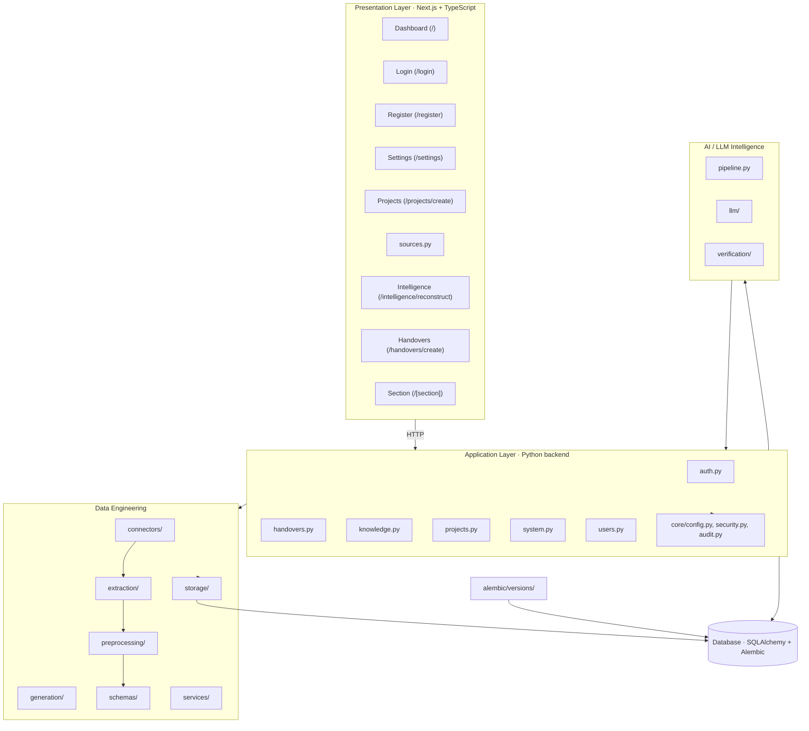
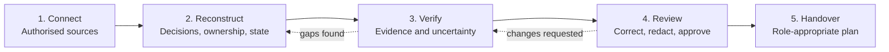

<div align="center">

# 🧭 HandoverOS

### Intelligent Knowledge Handover & Project Continuity Platform

**Preserve Knowledge. Maintain Continuity. Empower What Comes Next.**

[](https://www.python.org/)
[](https://fastapi.tiangolo.com/)
[](https://nextjs.org/)
[](https://www.typescriptlang.org/)
[](https://www.postgresql.org/)
[](LICENSE)

[Overview](#-overview) · [Capabilities](#-capabilities) · [Architecture](#-architecture) · [Getting Started](#-getting-started) · [Configuration](#-configuration) · [Running](#-running-the-application) · [Project Structure](#-project-structure) · [Team](#-team) · [License](#-license)

</div>

---

```text
Connect -> Reconstruct -> Verify -> Review -> Handover
Sources -> Ingestion -> Normalisation -> AI Extraction -> Evidence Linking -> Human Approval -> Controlled Sharing
```

> [!IMPORTANT]
> HandoverOS is a **decision-support tool**. Generated statements are proposals until an authorised reviewer approves them. AI output must never be treated as verified organisational truth, and information is never considered safe to share merely because it appears in a connected source.

> [!NOTE]
> **Project status.** HandoverOS is a hackathon project under active development (CodersInPune Hackathon, Team DEADLOCK). This README separates what exists in the repository from what is planned. Status markers: ✅ implemented · 🟡 partial or scaffolded · 🧭 planned. Nothing marked 🧭 is functional yet.

## 📑 Table of Contents

- [Overview](#-overview)
- [Problem Statement](#-problem-statement)
- [Proposed Solution](#-proposed-solution)
- [At a Glance](#-at-a-glance)
- [Capabilities](#-capabilities)
- [Architecture](#-architecture)
- [Five-Stage Workflow](#-five-stage-workflow)
- [Technology Stack](#-technology-stack)
- [Backend Architecture](#-backend-architecture)
- [Data Engineering Pipeline](#-data-engineering-pipeline)
- [AI/LLM Knowledge Intelligence Architecture](#-aillm-knowledge-intelligence-architecture)
- [Frontend Architecture](#-frontend-architecture)
- [Database Architecture](#-database-architecture)
- [Getting Started](#-getting-started)
- [Running the Application](#-running-the-application)
- [Configuration](#-configuration)
- [API Reference](#-api-reference)
- [Testing](#-testing)
- [Security and Privacy](#-security-and-privacy)
- [Repository Guide](#-repository-guide)
- [Project Structure](#-project-structure)
- [Limitations and Responsible Use](#-limitations-and-responsible-use)
- [Future Scope](#-future-scope)
- [Development and Contributions](#-development-and-contributions)
- [Team](#-team)
- [License](#-license)

---

## 🔎 Overview

HandoverOS is an intelligent knowledge-handover platform that converts scattered project activity into a structured, evidence-backed handover when a team member leaves, changes role, or becomes unavailable. It reconstructs the current state of a project from **authorised sources**, identifies decisions, ownership, risks, blockers and next actions, links every important claim to its supporting source, and marks uncertainty rather than inventing answers.

It was designed for the CodersInPune hackathon challenge **"Prevent Critical Knowledge From Leaving With People"**, and is built around three principles:

| Principle | Meaning |
|---|---|
| 🔗 **Traceable** | Important statements link back to reliable supporting sources. |
| ✅ **Actionable** | The incoming person understands ownership, risks and next steps. |
| 🔐 **Permission-aware** | People see only the information they are authorised to access. |

## ❓ Problem Statement

When people leave a project, documents may remain, but the reasoning behind decisions, unfinished work, dependencies, recurring problems and important contacts is scattered across repositories, messages, meeting notes and task boards. The result:

- Delayed onboarding and project transitions.
- Repeated investigations and duplicated work.
- Lost decision context and unclear ownership of unfinished tasks.
- Blockers and dependencies discovered too late.
- Difficulty telling which information is current and reliable.
- Risk of exposing confidential information through unrestricted sharing.

The problem is not simply missing documentation. It is the difficulty of reconstructing **reliable, contextual and actionable** knowledge from fragmented records.

## 💡 Proposed Solution

HandoverOS turns handover into a structured, human-controlled process:

1. Ingest authorised project material.
2. Normalise and validate it with source identifiers and timestamps preserved.
3. Use LLM-based extraction to identify decisions, responsibilities, risks, blockers, dependencies and pending tasks.
4. Link each claim to evidence and flag missing evidence, contradictions and uncertainty.
5. Let an authorised reviewer edit, reject, redact and approve the handover.
6. Share the approved handover only with authorised recipients, who can acknowledge receipt.

## ✨ At a Glance

| | Capability | Description | Status |
|---|---|---|---|
| 🔌 | **Source ingestion** | Bring in authorised documents and project activity. | 🟡 Extraction and validation modules present |
| 🧹 | **Normalisation** | Convert raw data into a consistent structure for AI processing. | 🟡 Module present |
| 🧠 | **Knowledge extraction** | Decisions, tasks, risks, blockers, dependencies. | 🧭 Planned |
| 🔗 | **Evidence linking** | Connect each claim to its supporting source. | 🧭 Planned |
| ⚠️ | **Uncertainty detection** | Flag missing, conflicting or unsupported information. | 🧭 Planned |
| 👀 | **Human review** | Edit, reject, redact and approve before sharing. | 🧭 Planned |
| 📤 | **Controlled handover** | Role-appropriate sharing with acknowledgement. | 🧭 Planned |

---

## 🧩 Capabilities

### 🔌 Source Hub

Initial MVP priority is **GitHub repositories** and **document uploads**. The proposal also lists further inputs as lower priority.

| Source | Planned support | Status |
|---|---|---|
| PDF and DOCX documents | MVP | 🟡 Extractor module present |
| GitHub repositories | MVP | 🧭 Planned |
| TXT and CSV files | Secondary | 🧭 Planned |
| Exported Slack and Discord conversations | Secondary | 🧭 Planned |
| Live Slack / Discord integrations | Future | 🧭 Planned |

### 🧠 Intelligence and Review Features

| Feature | Responsibility | Status |
|---|---|---|
| State reconstructor | Extract decisions, ownership, progress, blockers, risks, dependencies | 🧭 Planned |
| Evidence linking | Tie claims to messages, commits, issues or documents | 🧭 Planned |
| Uncertainty detector | Surface missing evidence and contradictions | 🧭 Planned |
| Project timeline | Chronological view of decisions and activity | 🧭 Planned |
| Role-based views | Handover content filtered by role and permissions | 🧭 Planned |
| Review and approval | Inspect, correct, reject, redact, approve | 🧭 Planned |
| Controlled sharing | Authorised recipients only | 🧭 Planned |
| Version history | Previous handovers, review decisions, approvals | 🧭 Planned |
| Dependency and risk identification | Relationships between tasks, issues and risks | 🧭 Planned |

### 🔀 Separate by Design

| Principle | Meaning |
|---|---|
| 🤝 Human in control | AI proposes; a reviewer approves before distribution. |
| 🧾 Clear provenance | Every record keeps its source references and review status. |
| ❓ Uncertainty first | Missing evidence is flagged, not silently filled in. |
| 🔒 No implicit access | Permissions are validated before retrieval or sharing. |

---

## 🏗️ Architecture

HandoverOS follows a modular, API-driven three-tier structure: a Next.js presentation layer, a Python backend with API, data engineering, and intelligence layers, and a persistence layer with SQLAlchemy/Alembic migrations.



Solid lines reflect the current repository layout.

<details>
<summary><strong>📌 Architecture notes</strong></summary>

- The frontend is a Next.js (TypeScript, App Router) application under `frontend/src/app/`. Routes: `/` (dashboard), `/login`, `/register`, `/settings`, `/projects/create`, `/sources/upload`, `/intelligence/reconstruct`, `/handovers/create`, and `/[section]`.
- Key frontend lib modules: `frontend/src/lib/api.ts`, `auth.ts`, `labels.ts`, `types.ts` (plus `metrics.ts`, `mock-data.ts`, `nav.ts`, `require-auth.ts`, `stages.ts`).
- Frontend components live under `frontend/src/components/` (`dashboard/`, `layout/`, `ui/`).
- The backend entry point is `backend/app/main.py`. API route modules under `backend/app/api/`: `auth.py`, `handovers.py`, `knowledge.py`, `projects.py`, `sources.py`, `system.py`, `users.py`. Core modules: `config.py`, `security.py`, `audit.py`.
- Database migrations are managed with Alembic under `backend/alembic/versions/`.
- Data engineering lives in `backend/data_engineering/` with connectors, extractors, generators, preprocessing, schemas, services, storage, and tests.
- AI/LLM intelligence lives in `backend/intelligence/` with pipeline, extraction, generation, llm, verification, schemas, adapters, config, fixtures, and tests.
- Root-level tests live in `tests/`.
- Read exact persistence behaviour and runtime settings from `backend/app/core/config.py`, `backend/data_engineering/config.py` and `.env.example` before deployment.
- See [`docs/architecture.md`](docs/architecture.md) and [`docs/data_flow.md`](docs/data_flow.md) for the detailed design.

</details>

---

## 🔄 Five-Stage Workflow



| Stage | What happens | Status |
|---|---|---|
| **01 Connect** | An outgoing member or project administrator connects authorised sources. The ingestion engine validates input and preserves source identifiers, timestamps and metadata. | 🟡 Extraction, normalisation and validation modules present; connectors planned |
| **02 Reconstruct** | The AI engine extracts decisions, responsibilities, unresolved questions, risks, blockers, dependencies and pending actions into structured records and a timeline. | 🧭 Planned |
| **03 Verify** | The verification engine checks claims against sources and flags missing evidence, contradictions, unsupported claims, unclear ownership and possibly outdated information. | 🧭 Planned |
| **04 Review** | A reviewer edits, corrects, rejects, resolves contradictions, redacts confidential content and approves. | 🧭 Planned |
| **05 Handover** | The approved report is shared with authorised incoming members, who can acknowledge receipt. | 🧭 Planned |

The planned handover report contains: project overview, current status, important decisions, responsibilities, pending tasks, risks and blockers, dependencies, unresolved questions, recommended next actions and supporting source references. See [`docs/user_workflow.md`](docs/user_workflow.md).

---

## 🛠️ Technology Stack

The stack below combines what is **confirmed by the repository layout** and what is **proposed in the Round 1 plan**. Exact versions are defined in `backend/requirements.txt` and `frontend/package.json`.

| Layer | Technology | Role | Status |
|---|---|---|---|
| 🖥️ Frontend | Next.js, TypeScript | Web application | 🟡 Scaffold (`layout.tsx`, `page.tsx`) |
| 🎨 Styling | Tailwind CSS | Interface styling | 🧭 Proposed |
| ⚡ Backend | Python, FastAPI | REST API and application logic | 🟡 Route modules present; framework per proposal |
| ✔️ Validation | Pydantic | Structured validation | 🟡 Proposed; used in `source_schema.py` if confirmed |
| 🗄️ Database | PostgreSQL (Supabase hosting) | Persistent storage | 🧭 Proposed |
| 🔗 ORM and migrations | SQLAlchemy, Alembic | Database access and schema management | 🧭 Proposed |
| 🔐 Auth | Supabase Auth, RBAC | Authentication and authorisation | 🧭 Proposed |
| 🧠 AI / LLM | OpenAI API or equivalent | Knowledge extraction | 🧭 Proposed |
| 🧬 Retrieval | Embeddings, PostgreSQL with pgvector | Semantic similarity search | 🧭 Proposed |
| 📄 Documents | PyMuPDF, python-docx | PDF and DOCX extraction | 🟡 Extractor module present; libraries per proposal |
| 🐙 Integration | GitHub REST API | Repository activity ingestion | 🧭 Proposed |
| ✅ Testing | pytest, Postman | Unit tests and API validation | 🟡 Test files present |
| 📦 Containers | Docker | Reproducible backend environment | 🟡 `backend/Dockerfile` present |
| ☁️ Deployment | Vercel, Render | Hosting | 🧭 Proposed |

> Confirm each 🟡 and 🧭 row against `requirements.txt` and `package.json` before publishing, and remove anything that is not actually declared there.

---

## ⚡ Backend Architecture

- **Entry point:** `backend/app/main.py`
- **API route modules:** `backend/app/api/auth.py`, `handovers.py`, `knowledge.py`, `projects.py`, `sources.py`, `system.py`, `users.py`
- **Core modules:** `backend/app/core/config.py`, `security.py`, `audit.py`
- **Database migrations:** `backend/alembic/versions/` (Alembic)
- **Packaging:** `backend/Dockerfile`, dependencies in `backend/requirements.txt`
- **Root-level tests:** `tests/`

Backend API routes and modules:

| Module | Responsibility |
|---|---|
| `auth.py` | Authentication (register, login, logout) |
| `handovers.py` | Handover creation and retrieval |
| `knowledge.py` | Knowledge item management |
| `projects.py` | Project CRUD and membership |
| `sources.py` | Source ingestion and retrieval |
| `system.py` | System health and status |
| `users.py` | User profile and listing |
| `core/config.py` | Application configuration |
| `core/security.py` | Security utilities |
| `core/audit.py` | Audit logging |

Planned backend modules (from the Round 1 proposal): API and application services · authentication and authorisation · data ingestion and integration · normalisation and validation · AI knowledge extraction · structured knowledge representation · evidence mapping and verification · handover generation · persistence · audit and approval management.

## 🧱 Data Engineering Pipeline

Located in `backend/data_engineering/`, structured as an independent Python package with its own configuration and tests.

| Component | Path | Responsibility |
|---|---|---|
| Configuration | `config.py` | Pipeline configuration |
| Ingestion pipeline | `ingestion_pipeline.py` | End-to-end ingestion orchestration |
| Connectors | `connectors/base_connector.py`, `document_connector.py`, `synthetic_repository_loader.py` | Source connectors |
| Extractors | `extractors/document_extractor.py` | Content extraction from documents |
| Generators | `generators/repository_generator.py` | Synthetic repository data generation |
| Preprocessing | `preprocessing/normalizer.py`, `validator.py` | Normalisation and validation |
| Schemas | `schemas/knowledge_schema.py`, `source_schema.py` | Source and knowledge schemas |
| Services | `services/evidence_service.py`, `knowledge_storage_service.py`, `knowledge_validation_service.py`, `retrieval_service.py`, `storage_service.py` | Business logic services |
| Storage | `storage/database.py`, `init_db.py`, `knowledge_repository.py`, `models.py`, `repository.py` | Persistence layer |
| Tests | `tests/` | 12 unit test modules |

Design goals: preserve **source identifiers, timestamps and original references** end to end so that evidence linking remains possible downstream. See [`docs/data_flow.md`](docs/data_flow.md).

## 🤖 AI/LLM Knowledge Intelligence Architecture

Located in `backend/intelligence/`, an implemented Python package for LLM-based knowledge extraction and verification.

| Module | Path | Responsibility |
|---|---|---|
| Configuration | `config.py` | Intelligence configuration |
| Pipeline | `pipeline.py` | End-to-end intelligence pipeline |
| Schemas | `schemas.py` | Knowledge item schemas |
| Adapters | `adapters.py` | External system adapters |
| Extraction | `extraction/extractor.py`, `prompts.py` | Knowledge extraction from sources |
| Generation | `generation/handover.py` | Handover report generation |
| LLM | `llm/client.py`, `factory.py`, `ollama_client.py` | LLM provider clients |
| Verification | `verification/contradictions.py`, `evidence.py` | Contradiction and evidence verification |
| Fixtures | `fixtures/expected_output.json`, `sample_sources.json` | Test fixtures |
| Tests | `tests/test_pipeline.py` | Pipeline tests |

Design principles:

- The AI **proposes**; a human **verifies**.
- Structured AI output is validated before it is stored.
- Verified information is kept separate from uncertain interpretation.
- No finding reaches a final handover without an evidence reference and a review decision.

## 🖥️ Frontend Architecture

- **Framework:** Next.js with TypeScript, App Router (`frontend/src/app/`)
- **Routes:**
  - `/` — Dashboard (`page.tsx`)
  - `/login` — Login (`login/page.tsx`)
  - `/register` — Registration (`register/page.tsx`)
  - `/settings` — Settings (`settings/page.tsx`)
  - `/projects/create` — Create project (`projects/create/page.tsx`)
  - `/sources/upload` — Upload source (`sources/upload/page.tsx`)
  - `/intelligence/reconstruct` — Intelligence reconstruction (`intelligence/reconstruct/page.tsx`)
  - `/handovers/create` — Create handover (`handovers/create/page.tsx`)
  - `/[section]` — Section catch-all (`[section]/page.tsx`)
- **Shell/layout:** `auth-shell.tsx`, `layout.tsx`, `globals.css`
- **Lib modules:** `lib/api.ts`, `auth.ts`, `labels.ts`, `types.ts`, `metrics.ts`, `mock-data.ts`, `nav.ts`, `require-auth.ts`, `stages.ts`
- **Components:** `components/dashboard/` (EvidencePanel, IntelligenceSummary, PipelineCard, ReadinessCard, StatTiles), `components/layout/` (MobileNav, Sidebar, ThemeToggle, Topbar), `components/ui/` (StatusChip)

Implemented interfaces:

| Interface | Purpose |
|---|---|
| Application dashboard | Entry point and project overview |
| Authentication | Login and registration |
| Project interfaces | Create projects |
| Source upload | Upload documents and repositories |
| AI findings presentation | Intelligence reconstruction |
| Handover review | Generate handovers |
| Settings | Application preferences |
| Backend API integration | Typed client via `lib/api.ts` |

## 🗄️ Database Architecture

The database design is documented in [`docs/database_design.md`](docs/database_design.md). The Round 1 proposal specifies PostgreSQL with the following **proposed** tables.

Alembic migrations exist under `backend/alembic/versions/`, and SQLAlchemy models live in `backend/data_engineering/storage/models.py`.

| Proposed table | Purpose |
|---|---|
| `Users` | User account information |
| `Projects` | Project details |
| `Project_Members` | Membership and roles |
| `Sources` | Connected sources and imported documents |
| `Activities` | Imported project activities |
| `Knowledge_Items` | Extracted decisions, risks, blockers and tasks |
| `Evidence_Links` | Links from claims to supporting sources |
| `Handovers` | Generated handover versions |
| `Handover_Items` | Individual handover statements |
| `Approvals` | Review and approval history |
| `Audit_Logs` | Record of important operations |

Every knowledge item is intended to retain its source references and review status.

---

## 🚀 Getting Started

The steps below set up a local development environment. Ports and start commands are in [Running the Application](#-running-the-application).

### 📋 Prerequisites

| Requirement | Needed for |
|---|---|
| [Git](https://git-scm.com/) | Cloning the repository |
| Python compatible with `backend/requirements.txt` | Backend and data engineering |
| Node.js and npm compatible with `frontend/package.json` | Frontend |
| [Docker](https://www.docker.com/) (optional) | Containerised backend |
| PostgreSQL / Supabase project (when persistence is enabled) | Database |
| LLM provider API key (when the AI layer is enabled) | AI extraction |

> [!NOTE]
> The database and LLM provider are **planned** components. Only install or configure them once the corresponding code exists in the repository.

### 1. Clone the repository

```powershell
git clone https://github.com/<your-org>/HandoverOS.git
cd HandoverOS
```

### 2. Configure the environment

```powershell
Copy-Item .env.example .env
```

Review `.env.example` and `backend/app/core/config.py`, and set only the variables the current implementation requires. Do not commit secrets or credentials.

### 3. Set up the backend

```powershell
py -m venv .venv
.\.venv\Scripts\Activate.ps1
python -m pip install --upgrade pip
pip install -r backend/requirements.txt
```

macOS / Linux:

```bash
python3 -m venv .venv
source .venv/bin/activate
pip install -r backend/requirements.txt
```

### 4. Set up the frontend

```powershell
cd frontend
npm install
cd ..
```

### 5. Start the application

Start the backend and frontend in separate terminals, as described in [Running the Application](#-running-the-application).

---

## 🚦 Running the Application

### 🔌 Ports and URLs

| Service | Address | Defined in |
|---|---|---|
| ⚡ Backend API | `127.0.0.1:8000` (Uvicorn default convention) | `backend/app/main.py` <!-- VERIFY --> |
| 🖥️ Frontend (Next.js) | `localhost:3000` (Next.js default) | `frontend/package.json` <!-- VERIFY --> |
| 🗄️ Database | Configured through environment variables | `.env.example` <!-- VERIFY --> |

> These are framework defaults. Confirm them against the actual scripts and configuration, and update this table if they differ.

### ⚡ Backend

The entry point is `backend/app/main.py`. If the application object is `app` (confirm in `main.py`), run from the `backend/` directory:

```powershell
cd backend
uvicorn app.main:app --reload --host 127.0.0.1 --port 8000
```

### 🖥️ Frontend

```powershell
cd frontend
npm run dev
```

### 🐳 Docker (backend)

```powershell
docker build -t handoveros-backend ./backend
```

<!-- VERIFY: exposed port and run command in backend/Dockerfile. -->

### 🔗 API connection and CORS

The frontend must be able to reach the backend origin, and the backend must allow the frontend origin through CORS. If you change a port, update the backend start command, the frontend API base URL and the CORS settings together.

---

## 🔧 Configuration

Copy `.env.example` to `.env` and review it alongside `backend/app/core/config.py` and `backend/data_engineering/config.py`. Do not commit `.env` or any credentials.

The variable names are defined in `.env.example`. Based on the proposed architecture, configuration will fall into these groups once the matching features exist:

| Group | Purpose | Status |
|---|---|---|
| Application settings | Environment, host and port, CORS origins | 🟡 `core/config.py` present |
| Database connection | PostgreSQL / Supabase connection details | 🧭 Planned |
| Authentication | Supabase Auth credentials | 🧭 Planned |
| LLM provider | API key and model selection | 🧭 Planned |
| GitHub integration | Access token for repository ingestion | 🧭 Planned |

<!-- VERIFY: replace this table with the real variable names from .env.example, with a one-line description each. Never include real values. -->

---

## 📡 API Reference

Route modules present under `backend/app/api/`:

| Area | Route module |
|---|---|
| 🔐 Authentication | [`backend/app/api/auth.py`](backend/app/api/auth.py) |
| 📁 Projects | [`backend/app/api/projects.py`](backend/app/api/projects.py) |
| 👤 Users | [`backend/app/api/users.py`](backend/app/api/users.py) |

Full reference: [`docs/api_documentation.md`](docs/api_documentation.md).

If the backend uses FastAPI, the interactive schema is served at `/docs` while the server is running, and it is the authoritative source for methods, request bodies, response models and paths.

<!-- VERIFY: list the real endpoints from the route decorators. Endpoints that appear only in docs but not in code should be marked planned. -->

---

## ✅ Testing

| Location | Scope |
|---|---|
| `backend/data_engineering/tests/` | Unit tests: `test_document_extractor.py`, `test_normalizer.py`, `test_source_schema.py`, `test_validator.py` |
| `tests/test_workflow.py` | Workflow-level test |

```powershell
python -m pytest -v
```

<!-- VERIFY: pytest is listed in requirements.txt, what test_workflow.py covers, and whether the suite passes. No frontend tests are present in the repository tree. -->

The proposal's evaluation targets (time to orientation, evidence traceability, action clarity, extraction quality, review usefulness, access discipline, user confidence) are **goals**, not achieved results. Results depend on your local environment; run the suite yourself before treating any test status as verified.

---

## 🔐 Security and Privacy

HandoverOS may process sensitive organisational information, so these principles are design requirements:

- Process only authorised, permissioned or appropriately anonymised project information.
- Validate user permissions before retrieving or sharing protected records.
- Use least-privilege access for source integrations.
- Keep API credentials and tokens in environment variables, never in source control. `.env.example` is a template only.
- Maintain source identifiers throughout the AI pipeline and validate structured AI output before storing it.
- Separate verified information from uncertain interpretation.
- Require authorised human approval before final distribution.
- Maintain audit records for important modifications and approvals.
- Use synthetic or anonymised data for demonstrations; avoid collecting unnecessary personal or confidential information.

> [!NOTE]
> These are the project's intended principles. Role-based access control, audit logging and redaction are 🧭 planned unless confirmed in code. Do not claim encryption or compliance certifications that are not implemented.

---

## 📚 Repository Guide

| Document | Description |
|---|---|
| [`docs/architecture.md`](docs/architecture.md) | Architecture and system design |
| [`docs/data_flow.md`](docs/data_flow.md) | Data flow through the pipeline |
| [`docs/database_design.md`](docs/database_design.md) | Database design |
| [`docs/api_documentation.md`](docs/api_documentation.md) | API documentation |
| [`docs/user_workflow.md`](docs/user_workflow.md) | End-to-end user workflow |

---

## 📂 Project Structure

A quick map of where things live:

| Path | Contents |
|---|---|
| 📁 `backend/app/` | Backend application: entry point (`main.py`), API route modules, core configuration |
| 📁 `backend/app/api/` | API route modules: `auth.py`, `handovers.py`, `knowledge.py`, `projects.py`, `sources.py`, `system.py`, `users.py` |
| 📁 `backend/app/core/` | Core modules: `config.py`, `security.py`, `audit.py` |
| 📁 `backend/alembic/` | Database migrations (`env.py`, `versions/`) |
| 📁 `backend/data_engineering/` | Data engineering: connectors, extractors, generators, preprocessing, schemas, services, storage, tests |
| 📁 `backend/intelligence/` | AI/LLM intelligence: pipeline, extraction, generation, LLM clients, verification, tests |
| 📁 `backend/tests/` | Root-level backend tests |
| 📁 `frontend/src/app/` | Next.js App Router pages and route segments |
| 📁 `frontend/src/components/` | React components: `dashboard/`, `layout/`, `ui/` |
| 📁 `frontend/src/lib/` | Lib modules: `api.ts`, `auth.ts`, `labels.ts`, `types.ts`, and more |
| 📁 `docs/` | Architecture, data flow, database, API and workflow documents |
| 📁 `tests/` | Workflow-level tests |

## HandoverOS — Project Architecture
```text
HandoverOS/
│
├── backend/
│   ├── app/
│   │   ├── __init__.py
│   │   ├── main.py
│   │   │
│   │   ├── api/
│   │   │   ├── __init__.py
│   │   │   ├── auth.py
│   │   │   ├── handovers.py
│   │   │   ├── knowledge.py
│   │   │   ├── projects.py
│   │   │   ├── sources.py
│   │   │   ├── system.py
│   │   │   └── users.py
│   │   │
│   │   └── core/
│   │       ├── audit.py
│   │       ├── config.py
│   │       └── security.py
│   │
│   ├── alembic/
│   │   ├── env.py
│   │   ├── README
│   │   ├── script.py.mako
│   │   └── versions/
│   │       ├── a46e340cb50a_create_initial_database_schema.py
│   │       ├── b3c9f1a2d4e5_add_source_records_table.py
│   │       ├── c1d2e3f4a5b6_add_source_id_to_handover_items.py
│   │       └── e85619cdeaea_add_user_sessions_table.py
│   │
│   ├── data_engineering/
│   │   ├── __init__.py
│   │   ├── config.py
│   │   ├── ingestion_pipeline.py
│   │   ├── README.md
│   │   │
│   │   ├── connectors/
│   │   │   ├── __init__.py
│   │   │   ├── base_connector.py
│   │   │   ├── document_connector.py
│   │   │   └── synthetic_repository_loader.py
│   │   │
│   │   ├── extractors/
│   │   │   ├── __init__.py
│   │   │   └── document_extractor.py
│   │   │
│   │   ├── generators/
│   │   │   ├── __init__.py
│   │   │   └── repository_generator.py
│   │   │
│   │   ├── preprocessing/
│   │   │   ├── normalizer.py
│   │   │   └── validator.py
│   │   │
│   │   ├── schemas/
│   │   │   ├── __init__.py
│   │   │   ├── knowledge_schema.py
│   │   │   └── source_schema.py
│   │   │
│   │   ├── services/
│   │   │   ├── __init__.py
│   │   │   ├── evidence_service.py
│   │   │   ├── knowledge_storage_service.py
│   │   │   ├── knowledge_validation_service.py
│   │   │   ├── retrieval_service.py
│   │   │   └── storage_service.py
│   │   │
│   │   ├── storage/
│   │   │   ├── __init__.py
│   │   │   ├── database.py
│   │   │   ├── init_db.py
│   │   │   ├── knowledge_repository.py
│   │   │   ├── models.py
│   │   │   └── repository.py
│   │   │
│   │   └── tests/
│   │       ├── __init__.py
│   │       ├── test_document_connector.py
│   │       ├── test_document_extractor.py
│   │       ├── test_evidence_service.py
│   │       ├── test_ingestion_pipeline.py
│   │       ├── test_knowledge_schema.py
│   │       ├── test_knowledge_storage_service.py
│   │       ├── test_normalizer.py
│   │       ├── test_retrieval_service.py
│   │       ├── test_source_schema.py
│   │       ├── test_storage_repository.py
│   │       ├── test_synthetic_repository_loader.py
│   │       └── test_validator.py
│   │
│   ├── intelligence/
│   │   ├── __init__.py
│   │   ├── adapters.py
│   │   ├── config.py
│   │   ├── pipeline.py
│   │   ├── schemas.py
│   │   │
│   │   ├── extraction/
│   │   │   ├── extractor.py
│   │   │   └── prompts.py
│   │   │
│   │   ├── fixtures/
│   │   │   ├── expected_output.json
│   │   │   └── sample_sources.json
│   │   │
│   │   ├── generation/
│   │   │   └── handover.py
│   │   │
│   │   ├── llm/
│   │   │   ├── client.py
│   │   │   ├── factory.py
│   │   │   └── ollama_client.py
│   │   │
│   │   ├── tests/
│   │   │   └── test_pipeline.py
│   │   │
│   │   └── verification/
│   │       ├── contradictions.py
│   │       └── evidence.py
│   │
│   ├── tests/
│   │   ├── test_auth.py
│   │   ├── test_knowledge_reconstruction.py
│   │   ├── test_migration_source_id.py
│   │   └── test_ollama_integration.py
│   │
│   ├── alembic.ini
│   ├── debug_alembic.py
│   ├── Dockerfile
│   └── requirements.txt
│
├── frontend/
│   ├── src/
│   │   ├── app/
│   │   │   ├── [section]/
│   │   │   │   └── page.tsx
│   │   │   ├── auth-shell.tsx
│   │   │   ├── globals.css
│   │   │   ├── handovers/
│   │   │   │   └── create/
│   │   │   ├── intelligence/
│   │   │   │   └── reconstruct/
│   │   │   ├── layout.tsx
│   │   │   ├── login/
│   │   │   │   └── page.tsx
│   │   │   ├── page.tsx
│   │   │   ├── projects/
│   │   │   │   └── create/
│   │   │   ├── register/
│   │   │   │   └── page.tsx
│   │   │   ├── settings/
│   │   │   │   └── page.tsx
│   │   │   └── sources/
│   │   │       └── upload/
│   │   │
│   │   ├── components/
│   │   │   ├── dashboard/
│   │   │   │   ├── EvidencePanel.tsx
│   │   │   │   ├── IntelligenceSummary.tsx
│   │   │   │   ├── PipelineCard.tsx
│   │   │   │   ├── ReadinessCard.tsx
│   │   │   │   └── StatTiles.tsx
│   │   │   │
│   │   │   ├── layout/
│   │   │   │   ├── MobileNav.tsx
│   │   │   │   ├── Sidebar.tsx
│   │   │   │   ├── ThemeToggle.tsx
│   │   │   │   └── Topbar.tsx
│   │   │   │
│   │   │   └── ui/
│   │   │       └── StatusChip.tsx
│   │   │
│   │   ├── lib/
│   │   │   ├── api.ts
│   │   │   ├── auth.ts
│   │   │   ├── labels.ts
│   │   │   ├── metrics.ts
│   │   │   ├── mock-data.ts
│   │   │   ├── nav.ts
│   │   │   ├── require-auth.ts
│   │   │   ├── stages.ts
│   │   │   └── types.ts
│   │   │
│   │   └── next-env.d.ts
│   │
│   ├── next.config.ts
│   ├── package.json
│   ├── package-lock.json
│   └── tsconfig.json
│
├── docs/
│   ├── api_documentation.md
│   ├── architecture.md
│   ├── data_engineering.md
│   ├── data_flow.md
│   ├── database_design.md
│   ├── limitations_and_future_scope.md
│   ├── testing_strategy.md
│   └── user_workflow.md
│
├── tests/
│   ├── __init__.py
│   └── test_workflow.py
│
├── .gitignore
├── CHANGELOG.md
├── docker-compose.yml
├── LICENSE
├── main.py
└── README.md
```

## ⚠️ Limitations and Responsible Use

- Handover quality depends on the completeness of imported records; incomplete sources limit reconstruction quality.
- Contradictory information requires human resolution.
- AI-generated extraction can be incomplete or incorrect and requires review.
- API rate limits and source permissions may restrict available information.
- Some tacit knowledge needs direct input from the departing contributor.
- Native integrations with every communication platform are not feasible in the hackathon scope; the MVP prioritises GitHub and document uploads.
- Current implementation is partial: see the status markers throughout this document.

HandoverOS should support a review process, not replace professional judgment or established handover procedures. Use only data you are authorised to access.

## 🔭 Future Scope

Committed Round 3 improvements (🧭 planned):

1. **Permission-aware Ask-Handover Chat:** query approved handover information with retrieval-augmented generation.
2. **Dependency graph visualisation:** relationships between decisions, tasks, blockers and dependencies.
3. **Automated risk and blocker detection:** better identification of risks and unresolved issues from activity.

Beyond the hackathon:

- Live Slack and Discord integrations
- Meeting intelligence (speech-to-text for decisions and action items)
- Advanced knowledge graph
- Knowledge health score
- Advanced role templates
- Enterprise authentication and on-premises deployment
- Continuous project monitoring
- Open-source core with optional hosted services

---

## 🤝 Development and Contributions

1. Fork the repository.
2. Create a focused feature branch.
3. Keep changes scoped, and add or update tests where appropriate.
4. Run the relevant tests (see [Testing](#-testing)).
5. Open a pull request describing the change and how you verified it.

For architectural context, see [`docs/architecture.md`](docs/architecture.md).

---

## 👥 Team

**Team DEADLOCK**, VIT Bhopal University · CodersInPune Hackathon

| Member | Department | Responsibilities |
|---|---|---|
| **Anway Basu** | Backend & API Development | FastAPI backend and REST endpoints; project management, authentication and access control; connecting ingestion, AI and database modules; request validation and error handling |
| **Aryan Chirag** | Data Engineering & Integration | Connectors for GitHub, document uploads and exported communication records; extraction from commits, messages, issues and documents; normalisation into structured formats; source metadata, timestamps and original references |
| **Soumallaya Mukherjee** | AI/LLM & Knowledge Intelligence, and Frontend Development | LLM integration; structured knowledge extraction; decision, task, risk and blocker identification; evidence tracing; contradiction and uncertainty detection; handover generation. Frontend: application dashboard, project interfaces, AI findings presentation, evidence inspection, handover review, backend API integration |
| **Achyut Roy** | Database, Security & DevOps | PostgreSQL schema design and SQLAlchemy operations; Docker, deployment and environment variables; permission validation and audit logging; synthetic datasets; unit, integration and end-to-end testing |

All members participate in system integration, documentation and final testing.

---

## 📄 License

This project is licensed under the terms of the [LICENSE](LICENSE) file in this repository.

<div align="center">

<sub>When a person leaves a project, the knowledge required to continue it should remain.</sub>

</div>
